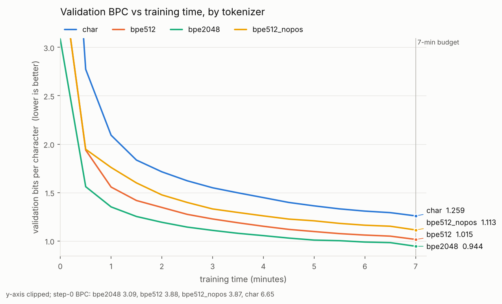
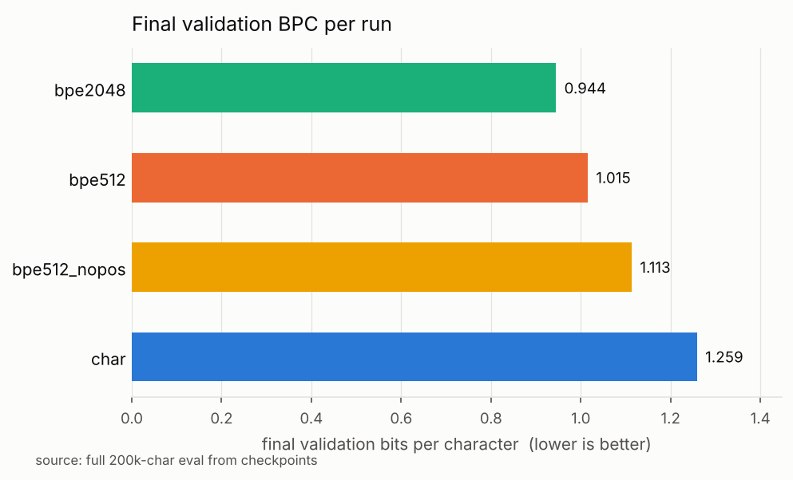
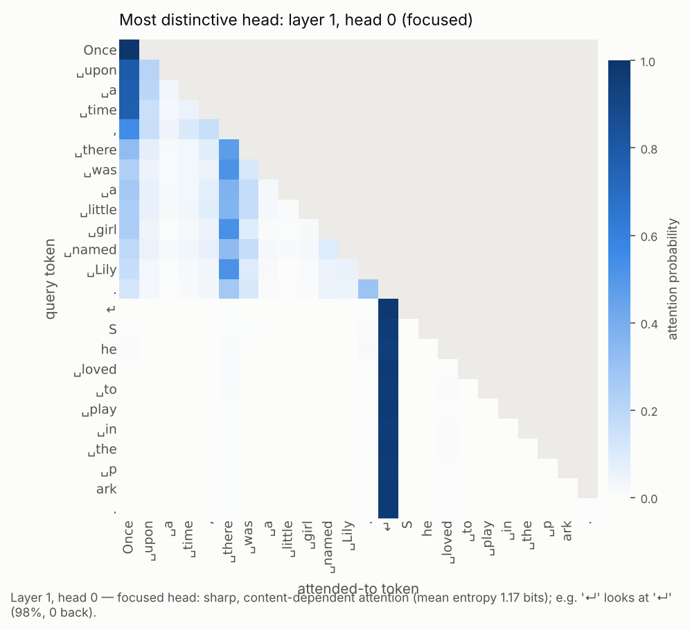
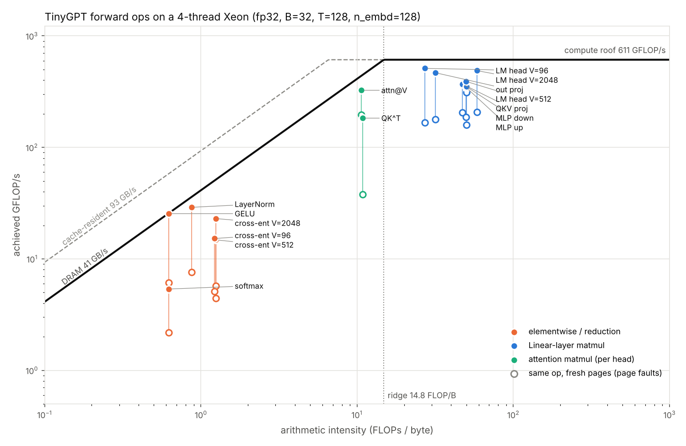

# Results: does the tokenizer matter?

**Yes, a lot.** With an identical 7-minute training budget on 4 CPU threads and the same ~0.79 M non-embedding
parameters, byte-level BPE with a 2048-token vocabulary compresses held-out TinyStories text to
**0.944 bits per character**, against **1.259 for the character-level model**. That is 25% fewer bits for the same text.

All numbers below are measured, not estimated. They come from `results/<run>/summary.json`, `results/<run>/log.csv`
and `checkpoints/<run>.pt`, produced by the commands in [README.md](README.md). Machine: 4-thread Intel Xeon
@ 2.1 GHz cloud VM, torch 2.15.0+cpu, seed 1337. The runs were executed one at a time.

## Summary table

| run | tokenizer | pos emb | vocab | params non-emb | params total | chars/token (val) | steps | train s | steps/s | tokens seen | chars seen | final val loss (nats/token) | **final val BPC** |
|---|---|---|---|---|---|---|---|---|---|---|---|---|---|
| `char` | char | yes | 96 | 793,344 | 822,016 | 1.000 | 3,958 | 420.1 | 9.42 | 16.21 M | 16.2 M | 0.8644 | **1.2585** |
| `bpe512` | bpe512 | yes | 512 | 793,344 | 875,264 | 2.371 | 3,994 | 420.1 | 9.51 | 16.36 M | 38.8 M | 1.6717 | **1.0151** |
| `bpe2048` | bpe2048 | yes | 2048 | 793,344 | 1,071,872 | 3.611 | 2,808 | 420.1 | 6.68 | 11.50 M | 41.5 M | 2.3670 | **0.9444** |
| `bpe512_nopos` | bpe512 | no | 512 | 793,344 | 858,880 | 2.371 | 4,116 | 420.1 | 9.80 | 16.86 M | 40.0 M | 1.8393 | **1.1130** |

- **params**: `GPT.num_params()`. *Non-emb* excludes `tok_emb` and `pos_emb`. *Total* counts the tied `lm_head` once.
  The non-embedding body is identical (793,344) for every run; only the embedding table (`V × 128`) and the
  position table (`128 × 128`, absent in `bpe512_nopos`) differ.
- **chars/token**: `len(val_text[:200000]) / len(encode(val_text[:200000]))`.
- **tokens seen** = steps × 32 × 128. **chars seen** = tokens seen × chars/token (approximate).
- **final val BPC**: `tinygpt.evaluate.bits_per_char` on the first 200,000 characters of the validation split.
  This text is byte-identical for every run. I re-ran it from the saved checkpoints after training and got the same four values.
- Training time is exactly the 420 s budget. Wall time per run was 433–438 s, because tokenisation (cached), evaluation and sampling are excluded from the budget.

### Throughput check (30-second runs, before the experiment)

| tokenizer | steps/s (30 s check) | steps/s (7-min run) | ms / step |
|---|---|---|---|
| char | 9.72 | 9.42 | 106 |
| bpe512 | 9.89 | 9.51 | 105 |
| bpe2048 | 6.83 | 6.68 | 150 |
| bpe512 (no pos emb) | – | 9.80 | 102 |

## Figures

**Caveat on the curves.** Rows logged *during* training use the first 50,000 validation characters. The last row,
and the checkpoint/table value, use the first 200,000. The 200k slice is slightly easier for every model. Re-evaluating
the final checkpoints on 50k vs 200k chars gives char 1.2801 / 1.2585, bpe512 1.0437 / 1.0151, bpe2048 0.9763 / 0.9444
and bpe512_nopos 1.1466 / 1.1130. So roughly 0.02–0.03 of the visible drop in the last segment of each curve comes
from the change of eval slice, not from learning. The ranking is the same on both slices.

Sanity check on step 0: an untrained model predicts roughly uniformly, so BPC ≈ log2(V) / (chars/token).
That gives char log2(96) = 6.58, bpe512 9 / 2.371 = 3.80 and bpe2048 11 / 3.611 = 3.05. The measured values
are 6.65, 3.88 and 3.09.

Attention grids for every run are in `results/figures/attention_<run>.png`. The automatically chosen "most
distinctive head" of each run is in `results/figures/attention_<run>_head.png`, and the captions are in
`results/figures/attention_captions.txt`.

## Samples from the best run (`bpe2048`)

Prompt `"Once upon a time"`, temperature 0.8, 200 new **tokens**. With bpe2048 that is about 720 characters.
The char run's samples are only about 200 characters, so compare quality, not length. Copied verbatim from
`results/bpe2048/samples.txt`. The `�` symbols at step 0 are lone byte tokens that don't decode to valid text.

<table>
<tr><th>step 0 (elapsed 0.0s)</th><th>step 685 (elapsed 105.0s)</th><th>step 1413 (elapsed 210.1s)</th><th>step 2808 (elapsed 420.1s)</th></tr>
<tr><td valign="top">Once upon a time think tooked al wokevell gift colorful criedamond hat high apple why Do Tom att ambbAmy flo roll piecesila Saraque itoud needed comingorm hairverake� satc parentpec woods gentle button looked sing brokegether childardec ask soon toysire danced treats P dream lunJ so reng pet enjoy}The job monster sometckst gi pa sw welcome She Everyone quick� will�! easash4 wonure hoU long� hair welc ran Sheep Hated noticedpping under ide import gra preizza Sam dinner swingny fox&#x27; girudden touch todayinll� was exc thanked ide without havegether��joy cra butterflyul road attimalQent All y smartlpve workedect feels count` food Fron living silly ro wind others Everyone frog�dy floor stand dolls nap a� Gecial k break going lonely broken better drivexOn picked storeouseGood into forestTh flowers earit H stop stre ve very until turned sit Blue years impuin</td><td valign="top">Once upon a time, there was a lackage. iggackage lived in a little town. The big rock loved to play in the pond. One day, the garden saw a big rock on the ground. The cat was red and wanted to have a fun. The mean bird tried to help, so he did not want to char it. The bird thought about of the bird, but he could not touch it. So, the bird flew down and said, &quot;I&#x27;m sorry by the nest today! I will use the tree to feed my blue tree.&quot; The little girl and her friends thanked the bird for all by the bird. They played together and became the best of the fun.   Once upon a time, in a small town, there lived a little boy named Tim. He had a big, red ball that liked to swim all day. One day, Tim wanted to go to the game. He wanted to run, so he wanted to play</td><td valign="top">Once upon a time, there was a big, green stick. The poor bird was hungry because it was a bitight. The bird looked around near the tree. The bird saw the tree and said, &quot;I am wet. I want to learn to fly.&quot; The bird looked at the tree and said, &quot;Hi, I amay cat!&quot; Then, the bird gave the bird a big, beautiful bird toe. The bird sang a happy song. Then, the song was happy, and the surprise is the talking cat.  Once upon a time, there was a little boy named Tim. Tim lived in a small house with a big, red bird. Tim liked to play with the sun. One day, he saw a big box in the yard. Tim had a big box of pot in his house. He liked to kick some autscuts. He said, &quot;Wow, come, I&#x27;m Tim!&quot; Tim was sad. He said, &quot;Wow,</td><td valign="top">Once upon a time, there was a little girl named Lily. She loved to play with her toy cars. One day, she found a toy car. It was shiny and had many pink cars. The car was shiny and pretty. Lily asked her mom, &quot;Mom, what is this?&quot; Her mom said, &quot;It&#x27;s a special car, Lily. But it&#x27;s difficult to put all the cars together.&quot; Lily and her mom had so much fun on the cartoon. They put a new cartoon in the dirt and went to the cart. They had so much fun. Lily was happy and loved her new cartime.  Once upon a time, there was a kind little girl named Lucy. She loved to make new friends. One day, she went to the park with her mom. They saw a big tree with a piece of water. Lucy was very excited. She wanted to go to the park. She wanted to try it</td></tr>
</table>

What the samples show, as BPC drops:

- At step 0 the output is random vocabulary.
- By 1.75 min the model produces grammatical TinyStories sentences but made-up words ("lackage") and drifting story logic.
- At 7 min the sentences are mostly coherent and stay on one topic, with occasional slips ("cartoon in the dirt", "cartime").

At the same 7 minutes the char model still misspells and mixes up characters and names (see
`results/char/samples.txt`: *"She loved to play with her friends in her mouth"*).

## The most interesting attention head: `bpe512_nopos`, layer 1, head 0, a "newline anchor"

This head comes from the model that has **no position embeddings**. On the probe sentence
`"Once upon a time, there was a little girl named Lily.↵She loved to play in the park."`:

- Every token after the newline puts **95–98%** of its attention on the `↵` token, up to 10 tokens back:
  `S`→`↵` 0.96, ` loved`→`↵` 0.97, … `.`→`↵` 0.97.
- Before the newline, the tokens of the first clause lock onto `Once` (0.55–0.79). After the comma they lock onto ` there` (0.33–0.53).

The head acts as a "start of the current segment" pointer. A model without position embeddings can't read a token's
index directly. Causal attention to a fixed anchor still gives it a usable signal of where it is in the text
(such as "this is the start of a new line"), and this head appears to be a learned way of getting that signal.
The auto-generated caption ("'↵' looks at '↵' (98%, 0 back)") picks a weak example. The values above come from
inspecting each query's argmax.

Runner-up, from the best run: **bpe2048, layer 2, head 1** (`results/figures/attention_bpe2048_head.png`) is a
similar phrase-anchor head. ` a`, ` little`, ` girl`, ` named`, ` Lily` all attend to the preceding ` a`
(0.78–0.98). After the full stop, `↵`, `She`, ` loved`, ` to` attend to `.` (0.33–0.58).
The char model has the character-level version (`attention_char_head.png`, layer 1 head 0). Each character holds
its attention on an anchor character near the start of the current word or phrase. For example, all of
`upon a t` attends to `u` (0.89–1.00), and `ittle ` attends to its `i` (0.63–0.93).

## Roofline (from [`roofline/ROOFLINE.md`](roofline/ROOFLINE.md))

I didn't re-run the roofline study. The numbers below are the committed measurements from the same type of VM.

Measured ops at the SPEC config (vocab 512, `B=32, T=128`, forward only):

| op | shape | FLOPs | bytes | FLOP/B | achieved GFLOP/s | % of roof | bound | µs / call | × per fwd | share of fwd time | fresh-pages µs (faults/call) |
|---|---|---|---|---|---|---|---|---|---|---|---|
| LayerNorm | `[4096,128]` | 3.7 M | 4.00 MiB | 0.87 | 29.0 | 80% | memory | 127 | 9 | 3.2% | 484 (513) |
| QKV proj | `[4096,128]@[128,384]` | 404.2 M | 8.19 MiB | 47.08 | 370.2 | 61% | compute | 1092 | 4 | 12.4% | 1961 (1537) |
| QK^T | `128x[128,32]@[32,128]` | 136.3 M | 12.00 MiB | 10.83 | 182.9 | 41% | memory | 745 | 4 | 8.5% | 3597 (4098) |
| softmax | `[32,4,128,128]` | 10.5 M | 16.02 MiB | 0.62 | 5.4 | 21% | memory | 1956 | 4 | 22.2% | 4810 (4098) |
| attn@V | `128x[128,128]@[128,32]` | 134.2 M | 12.00 MiB | 10.67 | 325.1 | 74% | memory | 413 | 4 | 4.7% | 685 (513) |
| out proj | `[4096,128]@[128,128]` | 134.7 M | 4.06 MiB | 31.63 | 467.7 | 77% | compute | 288 | 4 | 3.3% | 758 (513) |
| MLP up | `[4096,128]@[128,512]` | 539.0 M | 10.25 MiB | 50.14 | 343.0 | 56% | compute | 1572 | 4 | 17.8% | 3402 (2049) |
| GELU | `[4096,512]` | 10.5 M | 16.00 MiB | 0.62 | 25.4 | 99% | memory | 412 | 4 | 4.7% | 1721 (2049) |
| MLP down | `[4096,512]@[512,128]` | 537.4 M | 10.25 MiB | 50.00 | 351.0 | 57% | compute | 1531 | 4 | 17.4% | 1721 (513) |
| LM head V=512 | `[4096,128]@[128,512]` | 536.9 M | 10.25 MiB | 49.95 | 390.2 | 64% | compute | 1376 | 1 | 3.9% | 2860 (2049) |
| cross-ent V=512 | `[4096,512]` | 10.5 M | 8.03 MiB | 1.25 | 14.8 | 29% | memory | 708 | 1 | 2.0% | 1839 (2049) |

Vocabulary only changes the last two ops:

| vocab | LM head FLOP/B | LM head GFLOP/s | LM head µs | cross-ent µs | LM head + CE share of fwd |
|---|---|---|---|---|---|
| 96 | 27.1 | 512 | 197 | 129 | 1.1% |
| 512 | 50.0 | 390 | 1376 | 708 | 5.9% |
| 2048 | 58.5 | 488 | 4401 | 1825 | 19.1% |

Ridge point: 611 GFLOP/s ÷ 41.2 GB/s = 14.8 FLOP/byte.

- The Linear layers are compute-bound and run at ~60% of peak.
- softmax, LayerNorm, GELU and cross-entropy are memory-bound. They take 32% of the forward time for 1.6% of the FLOPs.
- softmax alone is the single most expensive op (22%).

**How the roofline predictions compare with the real runs.** The roofline's plain-torch replica predicted train steps of
113 ms (char), 129 ms (bpe512) and 186 ms (bpe2048), and ≈ 3257 steps in 7 minutes at vocab 512. The real
`tinygpt.model` runs measured **106, 105 and 150 ms** and completed **3,958 / 3,994 / 2,808 steps**.

- **Surprising: real runs were faster than the replica.** bpe512 completed 23% more steps than the roofline forecast.
  ROOFLINE.md itself warns that this shared VM varies by ±10–30% between runs, and the replica isn't the real model.
  The most likely explanation is run-to-run machine variance combined with small implementation differences.
- **Surprising: char was not faster per step than bpe512.** The roofline predicted char would be ~14% faster per step
  (smaller LM head and cross-entropy). In both of my measurements bpe512 was marginally faster
  (9.89 vs 9.72 and 9.51 vs 9.42 steps/s). At V ≤ 512 the vocabulary-dependent ops are only ~1–6% of the forward,
  so the expected difference is small and machine noise hides it.
- **As predicted: the slowdown at V = 2048 is real.** The 2048-way LM head and cross-entropy take ~19% of the forward. Steps were ~30% slower, which cost bpe2048 ~30% of its steps.

## Takeaways

1. **The tokenizer matters more than anything else we varied.** At an identical budget and identical body size:
   bpe2048 0.944 < bpe512 1.015 < bpe512_nopos 1.113 < char 1.259 BPC. Going from char to bpe2048 removes 25%
   of the bits needed to encode the validation text.
2. **Bigger tokens win even though steps are slower.** bpe2048 completed 30% fewer steps than bpe512 (2,808 vs 3,994)
   because its 2048-way output layer costs ~30% more per step. It still finished 0.07 BPC lower. Each of its tokens covers 3.6 characters, so it saw ~41.5 M characters
   of text (vs 38.8 M for bpe512 and 16.2 M for char), and its 128-token context spans ~460 characters instead of 128.
   Per step, the model's work grows slowly with the vocabulary, while the amount of text it covers grows quickly.
3. **Removing position embeddings costs ~0.10 BPC (1.015 → 1.113), but it doesn't break the model.**
   bpe512_nopos is still far better than char. This is *less* damage than one might expect from removing all
   explicit order information. The likely reason is that the causal mask leaks position: a token can count or
   anchor on what came before it, which is the known "NoPos" effect. The newline-anchor head above is consistent with that.
   It also did 3% more steps (9.80 vs 9.51 steps/s) by skipping the position add. That difference is within machine noise.
4. **BPE runs are starting to run out of data.** In 7 minutes the BPE models made 8.3–8.8 passes over the 4.75 M-char
   training split, against 3.4 for char. The end-of-run gap between train loss and validation loss grows with vocabulary:
   char 0.034, bpe512 0.171, bpe2048 0.326 nats/token. That is 4%, 10% and 14% of the validation loss.
   (Train loss here is the mean over the last ~30 s of training batches.) Validation BPC was still falling at the end of every run, so none of them overfitted past the best point.
   With a longer budget or a larger tokenizer, the 5 M-char corpus, not the CPU, would probably become the bottleneck.
5. **Per-token loss would have given the opposite answer.** Final validation loss is 0.864 nats/token for char vs
   2.367 for bpe2048, so comparing per-token loss would make char look ~2.7× better. After normalising by characters on identical text,
   bpe2048 is 25% better. On the systems side, the step is dominated by memory-bound elementwise ops and per-call
   overhead, not FLOPs (~31% of peak). So the real lever on this CPU is how much text each step covers,
   and the tokenizer controls that.

## Integration notes

- The full test suite (147 tests) passed on merged `main` before any run. I found no interface mismatches between modules, so no code changes were needed.
  I verified the real cross-module path end to end: tokenizers round-trip the real validation text, `train` writes
  checkpoints that `evaluate.load_checkpoint` loads, and `viz.make_all` renders from them. `demo.ipynb` passes `nbformat.validate`.
- Things the spec could tighten:
  - (a) `log.csv` mixes 50k-char and 200k-char BPC rows, which causes the caveat above. Logging both, or using one eval slice throughout, would avoid it.
  - (b) `sample_tokens` is counted in tokens, so sample lengths differ ~3.6× between runs.
  - (c) `train.py` progress output is block-buffered when redirected to a file. Use `python -u` to watch it live.
  - (d) The interesting-head caption's example picks the max-weight cell, which is often a trivial self-attention cell.
