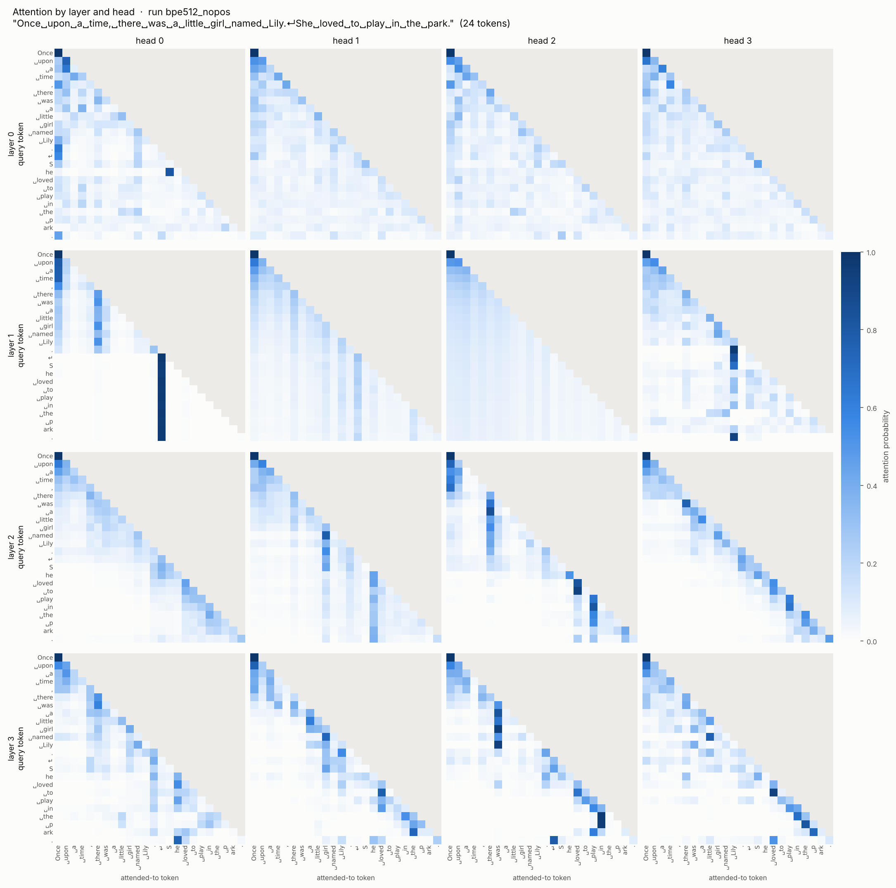

# Results: does the tokenizer matter?

**Yes, a lot.** With an identical 7-minute training budget on 4 CPU threads and the same ~0.79 M non-embedding
parameters, byte-level BPE with a 2048-token vocabulary compresses held-out TinyStories text to
**0.943 bits per character**, against **1.250 for the character-level model**. That is 25% fewer bits for the same text.
A second seed reproduces both numbers to within 0.001 BPC (see [Review fixes](#review-fixes)).

All numbers below are measured, not estimated. They come from `results/<run>/summary.json`, `results/<run>/log.csv`
and `checkpoints/<run>.pt`, produced by the commands in [README.md](README.md). Machine: 4-thread Intel Xeon
@ 2.3 GHz cloud VM, torch 2.15.0+cpu, seed 1337. The runs were executed one at a time. (All four runs were
re-run on this machine after the review fixes; the original 2.1 GHz numbers are in [Review fixes](#review-fixes).)

## Summary table

| run | tokenizer | pos emb | vocab | params non-emb | params total | chars/token (val) | steps | train s | steps/s | tokens seen | chars seen | final val loss (nats/token) | **final val BPC** |
|---|---|---|---|---|---|---|---|---|---|---|---|---|---|
| `char` | char | yes | 96 | 793,344 | 822,016 | 1.000 | 4,162 | 420.0 | 9.91 | 17.05 M | 17.0 M | 0.8590 | **1.2499** |
| `bpe512` | bpe512 | yes | 512 | 793,344 | 875,264 | 2.371 | 4,088 | 420.0 | 9.73 | 16.74 M | 39.7 M | 1.6678 | **1.0114** |
| `bpe2048` | bpe2048 | yes | 2048 | 793,344 | 1,071,872 | 3.611 | 2,897 | 420.1 | 6.90 | 11.87 M | 42.9 M | 2.3670 | **0.9434** |
| `bpe512_nopos` | bpe512 | no | 512 | 793,344 | 858,880 | 2.371 | 3,965 | 420.0 | 9.44 | 16.24 M | 38.5 M | 1.8402 | **1.1145** |

- **params**: `GPT.num_params()`. *Non-emb* excludes `tok_emb` and `pos_emb`. *Total* counts the tied `lm_head` once.
  The non-embedding body is identical (793,344) for every run; only the embedding table (`V × 128`) and the
  position table (`128 × 128`, absent in `bpe512_nopos`) differ. So the *total* parameter count is not equal:
  bpe2048 has 30% more parameters than char (1.07 M vs 0.82 M), all of them in the embedding table.
- **chars/token**: `len(val_text[:200000]) / len(encode(val_text[:200000]))`.
- **tokens seen** = steps × 32 × 128. **chars seen** = tokens seen × chars/token (approximate).
- **final val BPC**: `tinygpt.evaluate.bits_per_char` on the first 200,000 characters of the validation split.
  This text is byte-identical for every run. I re-ran it from the saved checkpoints after training and got the same four values.
- Training time is exactly the 420 s budget. Wall time per run was 432–437 s, because tokenisation (cached), evaluation and sampling are excluded from the budget.

### Throughput check (30-second runs, before the experiment)

| tokenizer | steps/s (30 s check, 2.1 GHz) | steps/s (original 7-min run, 2.1 GHz) | steps/s (7-min rerun, 2.3 GHz) | ms / step (rerun) |
|---|---|---|---|---|
| char | 9.72 | 9.42 | 9.91 | 101 |
| bpe512 | 9.89 | 9.51 | 9.73 | 103 |
| bpe2048 | 6.83 | 6.68 | 6.90 | 145 |
| bpe512 (no pos emb) | – | 9.80 | 9.44 | 106 |

## Figures


**Eval slice.** Every row of `log.csv`, including the last, scores the first 50,000 validation characters, so the
curves are self-consistent. The table and checkpoints use the first 200,000, which is slightly easier for every model:
final checkpoints score char 1.2751 / 1.2499, bpe512 1.0442 / 1.0114, bpe2048 0.9742 / 0.9434 and bpe512_nopos
1.1492 / 1.1145 on 50k / 200k chars. The ranking is the same on both slices. (Before the review fix the last row
alone switched to 200k, which drew an artificial 0.02–0.03 drop at the end of every curve.)

Sanity check on step 0: an untrained model predicts roughly uniformly, so BPC ≈ log2(V) / (chars/token).
That gives char log2(96) = 6.58, bpe512 9 / 2.371 = 3.80 and bpe2048 11 / 3.611 = 3.05. The measured values
are 6.65, 3.88 and 3.09.

Attention grids for every run are in `results/figures/attention_<run>.png`. The automatically chosen "most
distinctive head" of each run is in `results/figures/attention_<run>_head.png`, and the captions are in
`results/figures/attention_captions.txt`.

## Samples from the best run (`bpe2048`)

Prompt `"Once upon a time"`, temperature 0.8, 200 new **tokens**. With bpe2048 that is about 720 characters.
The char run's samples are only about 200 characters, so compare quality, not length. Copied verbatim from
`results/bpe2048/samples.txt`. The `�` symbols at step 0 are lone byte tokens that don't decode to valid text.

<table>
<tr><th>step 0 (elapsed 0.0s)</th><th>step 723 (elapsed 105.0s)</th><th>step 1473 (elapsed 210.1s)</th><th>step 2897 (elapsed 420.1s)</th></tr>
<tr><td valign="top"><sub>Once upon a time think tooked al wokevell gift colorful criedamond hat high apple why Do Tom att ambbAmy flo roll piecesila Saraque itoud needed comingorm hairverake� satc parentpec woods gentle button looked sing brokegether childardec ask soon toysire danced treats P dream lunJ so reng pet enjoy}The job monster sometckst gi pa sw welcome She Everyone quick� will�! easash4 wonure hoU long� hair welc ran Sheep Hated noticedpping under ide import gra preizza Sam dinner swingny fox&#x27; girudden touch todayinll� was exc thanked ide without havegether��joy cra butterflyul road attimalQent All y smartlpve workedect feels count` food Fron living silly ro wind others Everyone frog�dy floor stand dolls nap a� Gecial k break going lonely broken better drivexOn picked storeouseGood into forestTh flowers earit H stop stre ve very until turned sit Blue years impuin</sub></td><td valign="top"><sub>Once upon a time, there was a little girl named Lily! She liked to play in the park. One day, Mia found a big cat. She wanted to play with her friends.<br>Tom looked at her name was Lily. Tom said, &quot;Lily, has a big red ball. I&#x27;m Sue, and Lily. I had an idea. I am a fun day.&quot;<br>Lily felt so angry. She liked Lily&#x27;s hands and Sue had an idea. She did not know what to do with her new toy. Lily was making her ter.<br>Lily and Lily felt a mess. They played together. But they were very generous of the big surprise. But the big, a small cat came in her hands with the toy. They were friends happy and had a great day. Amy was very happy. The cat felt much. She did not touch the dog. Lucy was happy.<br>When they played, they played, Sally&#x27;s toy bear played together and had so much fun. They</sub></td><td valign="top"><sub>Once upon a time, there was a little girl named Amy. Amy was feeling very tired and happy. She wanted to eat her food. She thought of different fruits.<br>Amy got to her party with her friends, but she was also happy. She ran to the party. She said, &quot;Thank you, lady!&quot;<br>Amy felt good for being not nice. She said, &quot;You are in the party will make you feel better.&quot; The lady did more burn.<br>Soon, Amy felt sad. She did not want to share her dolls with her toys. She felt sorry for being naughty. She said, &quot;I wanted to help you clean the mailable. I will clean her room.&quot; mom was happy. She gave her a big hug.<br><br>Lily liked to play with her toys. She liked to draw in her room, cables, clothes, fine, and a car, who was a blue car. One day, Lily saw a broken car on the</sub></td><td valign="top"><sub>Once upon a time, in a small town, there was a little boy named Tim. Tim loved to play outside all day. One day, he found a big, round ball in the park. It was so shiny and nice. Tim thought, &quot;I can use it to play with the ball now?&quot;<br>Tim went to the little red ball and started to play with it. It was a fun game. Tim threw the ball very far. He wanted to throw it, but he was very far. He tried to pull and pull, but it was too hard.<br>Then, something unexpected happened. The big cat jumped and laughed. The cat was very happy. It did not see Tim&#x27;s car free. Tim was sad and wanted to play with it again. The big dog became good friends and played with his friends every day.<br><br>Once upon a time, there was a little boy named Tim. Tim had a toy drum. He loved to play with his drum in his drum.</sub></td></tr>
</table>

What the samples show, as BPC drops:

- At step 0 the output is random vocabulary.
- By 1.75 min the model produces grammatical TinyStories sentences, but names and story logic drift
  ("Tom looked at her name was Lily").
- At 7 min the sentences are mostly coherent and stay on one topic, with occasional slips ("I can use it to play
  with the ball now?", "his drum in his drum").

At the same 7 minutes the char model still mixes up characters and names (see `results/char/samples.txt`:
*"a little girl named Sam. Sam loved to play in the park. One day, Lily found a big stick"*), and at 3.5 min it
still invents words ("scard").

## The most interesting attention head: `bpe512_nopos`, layer 1, head 0, a "newline anchor"



Layer 1 (second row), head 0 (first column) of the grid above. This head comes from the model that has
**no position embeddings**. On the probe sentence
`"Once upon a time, there was a little girl named Lily.↵She loved to play in the park."`:

- Every token after the newline puts **72–93%** of its attention on the `↵` token, up to 10 tokens back:
  `S`→`↵` 0.83, ` loved`→`↵` 0.93, … `.`→`↵` 0.88.
- Before the newline, the tokens of the first clause lock onto `Once` (0.80 for ` upon`, decaying to 0.15–0.23
  by the end of the clause).
- No head in the char, bpe512 or bpe2048 models does this: their best "post-newline tokens attend to `↵`" head
  averages at most 0.15, against 0.88 here. The same head appeared, slightly sharper (0.95–0.98), in the original
  pre-review checkpoint, so it is not a one-off.

The head acts as a "start of the current segment" pointer. A model without position embeddings can't read a token's
index directly. Causal attention to a fixed anchor still gives it a usable signal of where it is in the text
(such as "this is the start of a new line"), and this head appears to be a learned way of getting that signal.
The automatically chosen "most distinctive head" for this run (`attention_bpe512_nopos_head.png`) is a different
head (layer 3, head 2), so the grid is the figure to look at. The values above come from inspecting each query's argmax.

Runner-up, from the best run: **bpe2048, layer 2, head 1** (`results/figures/attention_bpe2048.png`) is a
weaker phrase-anchor head. ` a`, ` little`, ` girl`, ` named`, ` Lily` all attend to the preceding ` a`
(0.38–0.88). After the full stop, `↵` attends to `.` (0.34) and the second sentence spreads over `She`, ` loved`
and `.` (0.20–0.33).
The char model has the character-level version (`attention_char.png`, layer 1 head 0). Each character holds
its attention on an anchor character near the start of the current word or phrase. For example, `pon a`
attends to `u` (0.64–0.93), `rl` attends to the `i` of `girl` (0.85–0.86) and `ark` attends to its `p` (0.72–0.79).

## Roofline (from [`roofline/ROOFLINE.md`](roofline/ROOFLINE.md))

I didn't re-run the roofline study. The numbers below are the committed measurements from the same type of VM.


Measured ops at the SPEC config (vocab 512, `B=32, T=128`, forward only):

| op | shape | FLOPs | bytes | FLOP/B | achieved GFLOP/s | memory roof | % of roof | % of DRAM roof | bound | µs / call | × per fwd | share of fwd time | fresh-pages µs (faults/call) |
|---|---|---|---|---|---|---|---|---|---|---|---|---|---|
| LayerNorm | `[4096,128]` | 3.7 M | 4.00 MiB | 0.87 | 29.0 | cache | 36% | 80% | memory | 127 | 9 | 3.2% | 484 (513) |
| QKV proj | `[4096,128]@[128,384]` | 404.2 M | 8.19 MiB | 47.08 | 370.2 | cache | 61% | 61% | compute | 1092 | 4 | 12.4% | 1961 (1537) |
| QK^T | `128x[128,32]@[32,128]` | 136.3 M | 12.00 MiB | 10.83 | 182.9 | cache | 30% | 41% | compute | 745 | 4 | 8.5% | 3597 (4098) |
| softmax | `[32,4,128,128]` | 10.5 M | 16.02 MiB | 0.62 | 5.4 | cache | 9% | 21% | memory | 1956 | 4 | 22.2% | 4810 (4098) |
| attn@V | `128x[128,128]@[128,32]` | 134.2 M | 12.00 MiB | 10.67 | 325.1 | cache | 53% | 74% | compute | 413 | 4 | 4.7% | 685 (513) |
| out proj | `[4096,128]@[128,128]` | 134.7 M | 4.06 MiB | 31.63 | 467.7 | cache | 77% | 77% | compute | 288 | 4 | 3.3% | 758 (513) |
| MLP up | `[4096,128]@[128,512]` | 539.0 M | 10.25 MiB | 50.14 | 343.0 | cache | 56% | 56% | compute | 1572 | 4 | 17.8% | 3402 (2049) |
| GELU | `[4096,512]` | 10.5 M | 16.00 MiB | 0.62 | 25.4 | cache | 44% | 99% | memory | 412 | 4 | 4.7% | 1721 (2049) |
| MLP down | `[4096,512]@[512,128]` | 537.4 M | 10.25 MiB | 50.00 | 351.0 | cache | 57% | 57% | compute | 1531 | 4 | 17.4% | 1721 (513) |
| LM head V=512 | `[4096,128]@[128,512]` | 536.9 M | 10.25 MiB | 49.95 | 390.2 | cache | 64% | 64% | compute | 1376 | 1 | 3.9% | 2860 (2049) |
| cross-ent V=512 | `[4096,512]` | 10.5 M | 8.03 MiB | 1.25 | 14.8 | cache | 13% | 29% | memory | 708 | 1 | 2.0% | 1839 (2049) |

Vocabulary only changes the last two ops:

| vocab | LM head FLOP/B | LM head GFLOP/s | LM head µs | cross-ent µs | LM head + CE share of fwd |
|---|---|---|---|---|---|
| 96 | 27.1 | 512 | 197 | 129 | 1.1% |
| 512 | 50.0 | 390 | 1376 | 708 | 5.9% |
| 2048 | 58.5 | 488 | 4401 | 1825 | 19.1% |

Ridge points: 611 GFLOP/s ÷ 41.2 GB/s (DRAM) = 14.8 FLOP/byte; 611 ÷ 93 GB/s (cache) = 6.6 FLOP/byte. Every op's
working set here is 4–16 MiB, which the bandwidth sweep shows runs at cache speed, so ops are judged against the
cache roof ("memory roof" column; the DRAM-roof percentage is kept for comparison).

- The Linear layers are compute-bound and run at ~60% of peak. They take 55% of the summed forward op time.
- The attention matmuls (QK^T, attn@V, 10.7–10.8 FLOP/B) are compute-bound against the cache roof, at 30% / 53% of it. (Before the
  review fix they were labelled memory-bound against the DRAM roof.)
- softmax, LayerNorm, GELU and cross-entropy are memory-bound. They take 32% of the forward time for 1.6% of the FLOPs,
  and reach only 9–44% of the cache roof (GELU's "99%" was against the DRAM roof).
- softmax alone is the single most expensive op (22%).

**How the roofline predictions compare with the real runs.** The roofline's plain-torch replica predicted train steps of
113 ms (char), 129 ms (bpe512) and 186 ms (bpe2048), and ≈ 3257 steps in 7 minutes at vocab 512. The real
`tinygpt.model` runs measured 106, 105 and 150 ms on the original 2.1 GHz VM and **101, 103 and 145 ms** in the
2.3 GHz rerun, completing **4,162 / 4,088 / 2,897 steps**.

- **Real runs were faster than the replica.** bpe512 completed 26% more steps than the roofline forecast.
  ROOFLINE.md itself warns that this shared VM varies by ±10–30% between runs, and the replica isn't the real model
  (the rerun is also on a faster CPU).
- **char vs bpe512 per step is within noise.** The roofline predicted char would be ~14% faster per step. In the original
  runs bpe512 was marginally faster (9.51 vs 9.42 steps/s); in the rerun char was (9.91 vs 9.73). The sign flips between
  runs, so the earlier "surprise" was machine noise. At V ≤ 512 the vocabulary-dependent ops are only ~1–6% of the forward.
- **As predicted: the slowdown at V = 2048 is real.** The 2048-way LM head and cross-entropy take ~19% of the forward. Steps took ~40% longer (145 vs 103 ms), which cost bpe2048 ~29% of its steps.

## Takeaways

1. **The tokenizer matters more than anything else we varied.** At an identical budget and identical body size:
   bpe2048 0.943 < bpe512 1.011 < bpe512_nopos 1.115 < char 1.250 BPC. Going from char to bpe2048 removes 25%
   of the bits needed to encode the validation text. Only two things were varied (tokenizer and position embeddings),
   so "more than anything else" is a statement about those two. Every gap is far above the noise we measured:
   ±0.001 BPC across seeds for bpe512 and bpe2048, ≤ 0.009 between the original and rerun machines, and a 95%
   interval of about ±0.007 from the choice of validation text.
2. **Bigger tokens win even though steps are slower.** bpe2048 completed 29% fewer steps than bpe512 (2,897 vs 4,088)
   because its 2048-way output layer costs ~40% more per step. It still finished 0.068 BPC lower (0.067 with seed 1338).
   Each of its tokens covers 3.6 characters, so it saw ~42.9 M characters of text (vs 39.7 M for bpe512 and 17.0 M
   for char), and its 128-token context spans ~460 characters instead of 128.
   Part of the win is that longer context, not only the extra text: scored with a window of ~128 characters
   (36 tokens for bpe2048, 54 for bpe512), the models get 1.027 (bpe2048) and 1.088 (bpe512) vs char's 1.250. So
   about a quarter of the char → bpe2048 gain (0.083 of 0.307 BPC) comes from seeing more characters of context at
   the same 128-token cost. The bpe2048 model also has 30% more (embedding) parameters, which this experiment
   cannot separate from the tokenizer.
3. **Removing position embeddings costs ~0.10 BPC (1.011 → 1.115), but it doesn't break the model.**
   bpe512_nopos is still far better than char. This is *less* damage than one might expect from removing all
   explicit order information. The likely reason is that the causal mask leaks position: a token can count or
   anchor on what came before it, which is the known "NoPos" effect. The newline-anchor head above is consistent with that.
   Its step speed is the same as bpe512 within machine noise (9.80 vs 9.51 steps/s originally, 9.44 vs 9.73 in the rerun).
   This run is also the least stable one: with seed 1338 it scored 1.140 instead of 1.115, so the cost of removing
   position embeddings is 0.10–0.13 BPC depending on the seed, not a precise 0.10.
4. **BPE runs are starting to run out of data.** In 7 minutes the BPE models made 8.1–9.0 passes over the 4.75 M-char
   training split, against 3.6 for char. The end-of-run gap between train loss and validation loss grows with vocabulary:
   char 0.039, bpe512 0.164, bpe2048 0.278 nats/token. That is 5%, 10% and 12% of the validation loss.
   (Both losses are measured on the final checkpoint over 640 fixed 128-token windows, from the train and validation
   splits. The earlier version used the running mean of the last ~30 s of training batches, which overstated the
   bpe2048 gap as 0.326.) On the consistent 50k-char slice, validation BPC still fell over the last 30 s of every run
   (by 0.002–0.010), so none of them overfitted past the best point.
   With a longer budget or a larger tokenizer, the 5 M-char corpus, not the CPU, would probably become the bottleneck.
5. **Per-token loss would have given the opposite answer.** Final validation loss is 0.864 nats/token for char vs
   2.367 for bpe2048, so comparing per-token loss would make char look ~2.7× better. After normalising by characters on identical text,
   bpe2048 is 25% better. On the systems side, the step runs at ~31% of peak FLOP/s. Of the profiled forward op
   time, the Linear matmuls take the largest share (55%), and memory-bound elementwise ops take 32% for 1.6% of the
   FLOPs. The forward is ~36% longer than the sum of its profiled ops, and the backward was not profiled per op.
   So the elementwise ops are a disproportionate cost, but they do not dominate the step. Since the step cost is
   nearly independent of the tokenizer below V = 2048, the lever the tokenizer pulls is how much text each step covers.

## Review fixes

An independent review tried to falsify the conclusions above by running code against the checkpoints. Ranked
findings, and what was done about each:

| # | finding | severity | fix | changes a conclusion? |
|---|---|---|---|---|
| 1 | Single seed, wall-clock budget on a VM whose speed varies ±10–30%: no noise floor for 0.07–0.10 BPC gaps | medium | `--seed` / `run_training(seed=)`; second seed for bpe512, bpe2048, bpe512_nopos | No: tokenizer gaps hold (±0.001 across seeds). The no-pos-emb cost is 0.10–0.13, not a precise 0.10 |
| 2 | Last `log.csv` row switched the eval slice 50k → 200k chars, drawing a fake 0.02–0.03 drop at the end of every curve | medium | Every row uses the 50k slice; 200k only in checkpoint/summary | No: "still falling at the end" holds on the consistent slice |
| 3 | Roofline judged cache-resident ops (4–16 MiB) against the DRAM roof: inflated % of roof (GELU 99%, LayerNorm 80%), QK^T / attn@V mislabelled memory-bound | medium | `op_rows` picks the cache or DRAM roof per op from the measured bandwidth sweep; ROOFLINE.md re-rendered from the committed `results.json` | Yes for the roofline table: 4/11 memory-bound ops, not 6/11 |
| 4 | "The step is dominated by memory-bound elementwise ops and per-call overhead, not FLOPs" contradicted the repo's own table (Linear 55% of op time, elementwise 32%; backward not profiled) | medium | Takeaway 5 and ROOFLINE.md takeaway 2 rewritten to the measured shares | Yes: that systems claim is withdrawn |
| 5 | Train/val gap used the running mean of training batches | low | Recomputed on fixed windows (takeaway 4) | No (bpe2048 gap 0.326 → 0.278) |
| 6 | Part of the BPE win is longer character context, and bpe2048 has 30% more (embedding) parameters | low (interpretation) | Quantified in takeaway 2 | Refines takeaway 2 |
| 7 | "char not faster per step than bpe512" reported as a surprise | low | The rerun flips the sign: it was noise | Withdrawn |

Checks that **passed** (no change needed): perturbing future tokens changes earlier logits by exactly 0.0 in all four
checkpoints, and attention above the diagonal is exactly 0; the BPE tokenizers' stored sha256 matches `train[:2M]`,
no validation story appears verbatim in train, and only 1.2% of 50-char validation substrings occur in train; an
independent per-token re-implementation of BPC matches `bits_per_char` to 5 decimals and covers exactly the same
200,000 characters for every run; parameter counts match a manual count; `y == x + 1` for every batch; the LR
schedule is a linear warmup to 1.0 at 5%, then cosine to 0.1; `top_k=1` sampling equals greedy; the budget
excludes tokenisation, eval and sampling.

**Before → after.** Because the logging fix changes `log.csv`, all four runs were re-run, one at a time, with the
fixed code. The rerun VM was a 2.3 GHz Xeon instead of 2.1 GHz, so step counts moved by up to 5%. Re-running all four
keeps them on one machine.

| run | final val BPC before (2.1 GHz) | after (2.3 GHz, seed 1337) | seed 1338 (2.3 GHz) | steps before → after | steps/s before → after |
|---|---|---|---|---|---|
| `char` | 1.2585 | **1.2499** | – | 3,958 → 4,162 | 9.42 → 9.91 |
| `bpe512` | 1.0151 | **1.0114** | 1.0104 | 3,994 → 4,088 | 9.51 → 9.73 |
| `bpe2048` | 0.9444 | **0.9434** | 0.9436 | 2,808 → 2,897 | 6.68 → 6.90 |
| `bpe512_nopos` | 1.1130 | **1.1145** | 1.1403 | 4,116 → 3,965 | 9.80 → 9.44 |

The ranking, the 25% char → bpe2048 reduction and the step-0 sanity values (unchanged, same seed) all reproduce.
The seed-1338 runs are in `results/seed_check/` (logs, samples, summaries; their checkpoints are not committed).
The roofline measurements were not redone. Only their interpretation changed.

Reproduce a seed run:

```bash
python -m tinygpt.train --run_name bpe2048_s1338 --tokenizer bpe2048 --time_budget_min 7 --seed 1338 --results_dir results/seed_check
```

## Integration notes

- The full test suite (147 tests) passed on merged `main` before any run. I found no interface mismatches between modules, so no code changes were needed.
  I verified the real cross-module path end to end: tokenizers round-trip the real validation text, `train` writes
  checkpoints that `evaluate.load_checkpoint` loads, and `viz.make_all` renders from them. `demo.ipynb` passes `nbformat.validate`.
- Things the spec could tighten:
  - (a) ~~`log.csv` mixes 50k-char and 200k-char BPC rows~~ Fixed in review: one eval slice throughout.
  - (b) `sample_tokens` is counted in tokens, so sample lengths differ ~3.6× between runs.
  - (c) `train.py` progress output is block-buffered when redirected to a file. Use `python -u` to watch it live.
  - (d) The interesting-head caption's example picks the max-weight cell, which is often a trivial self-attention cell.
