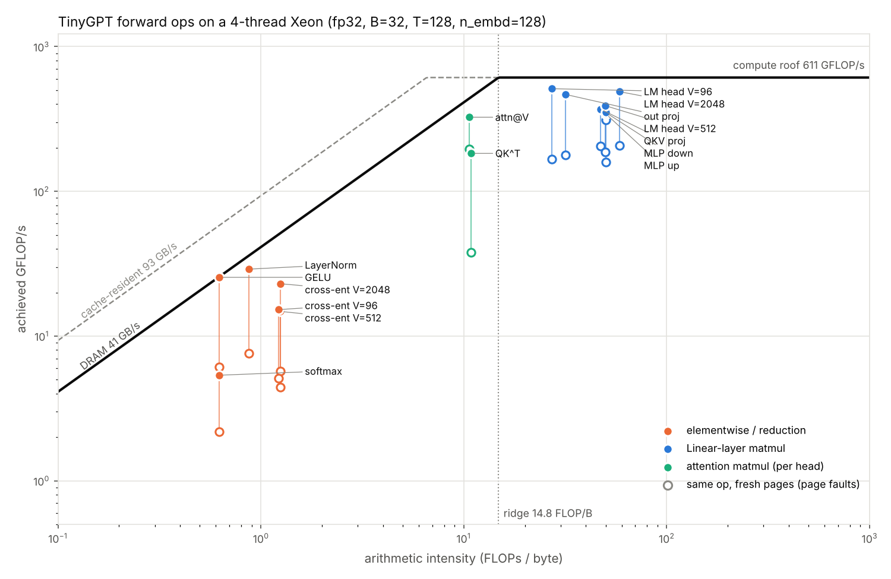
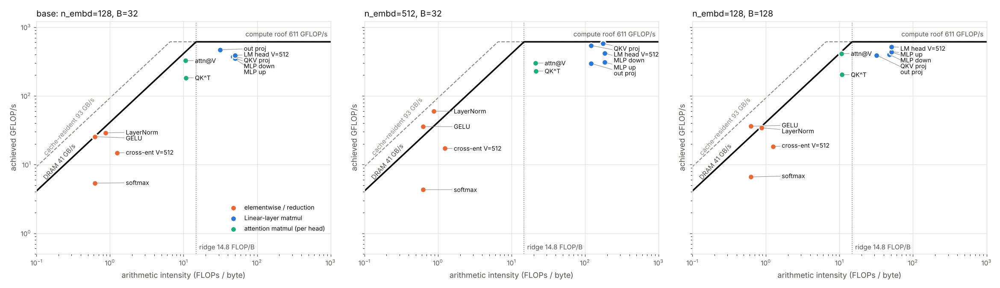

# Roofline: why TinyGPT trains as fast as it does on this machine

_Generated by `python -m roofline.run` (Agent G). All numbers below are measured on this machine unless marked as formulas; re-running overwrites this file._

## 1. Machine ceilings

- CPU: Intel(R) Xeon(R) Processor @ 2.10GHz, 4 threads (`torch.set_num_threads(4)`), fp32, torch 2.15.0+cpu.
- **Peak compute: 611 GFLOP/s** = best large square `torch.mm` (n=1024: 611, n=2048: 564, n=3072: 611, n=4096: 551 GFLOP/s; best of 5 repeats after warmup). From first principles a core retires 2 AVX-512 FMAs x 16 fp32 lanes x 2 FLOPs = 64 FLOPs/cycle, i.e. 4 x 2.1 GHz x 64 = 538 GFLOP/s at the nominal clock; the measured peak implies an effective 2.39 GHz (turbo), so MKL's big GEMM runs at the hardware limit.
- **Memory bandwidth: 41.2 GB/s** = best of STREAM-style copy (40.4 GB/s) and a+b (41.2 GB/s) over 256 MiB fp32 arrays (traffic counted as bytes read + bytes written).
- Bandwidth vs array size (a+b, per-array MiB -> GB/s): 1: 226, 4: 92, 16: 93, 64: 65, 256: 40, 1024: 39. 1 MiB arrays (3 MiB working set) live in the four 2 MiB L2s. The OS reports a 260 MB L3, but this VM effectively gets a slice of it: 4-16 MiB arrays -- the size of our activations -- run at 93 GB/s (2.3x DRAM; dashed line in the plots), and bandwidth falls to the DRAM level once the working set passes ~200 MiB.
- **Ridge point = 611 / 41.2 = 14.8 FLOPs per byte.** An op needs more than ~15 FLOPs per byte moved to be compute-bound; below that, DRAM bandwidth caps it. **For working sets up to 48 MiB** (the sweep's cache-speed range, x3 arrays for a+b) the memory ceiling is the cache bandwidth, so the ridge is **611 / 93 = 6.6 FLOPs per byte**. Every per-op working set of the base config is in that range, so the op table below classifies ops against the cache roof (DRAM-roof percentages are kept in their own column).

## 2. FLOPs and bytes per op (formulas)

`B=32, T=128, C=n_embd=128, H=4, hd=C/H=32, L=4, M=B*T=4096`, fp32 (s=4 bytes). FLOPs count a multiply-add as 2 and each elementwise op or `exp`/`erf` as 1. Bytes are the *compulsory* traffic of a perfectly fused kernel: inputs + weights read once, output written once. Full derivations are the docstrings of [`roofline/flops.py`](flops.py).

| op | FLOPs (one call) | bytes ÷ 4 = fp32 elements moved (one call) | calls per forward |
|---|---|---|---|
| LayerNorm | 7·M·C | 2·M·C + 2·C | 2L+1 = 9 |
| QKV proj | 2·M·C·3C + 3·M·C | M·C + 3C² + 3C + 3·M·C | L |
| QK^T (× 1/√hd) | 2·B·T²·C + B·H·T² | 2·B·T·C + B·H·T² | L |
| softmax (+ causal mask) | 5·B·H·T² | 2·B·H·T² (+ T²/4 for the bool mask) | L |
| attn@V | 2·B·T²·C | B·H·T² + 2·B·T·C | L |
| out proj | 2·M·C² + M·C | 2·M·C + C² + C | L |
| MLP up | 8·M·C² + 4·M·C | 5·M·C + 4C² + 4C | L |
| GELU (exact, erf) | 5·4·M·C | 2·4·M·C | L |
| MLP down | 8·M·C² + M·C | 5·M·C + 4C² + C | L |
| LM head (tied, no bias) | 2·M·C·V | M·C + C·V + M·V | 1 |
| cross-entropy (training extra) | 5·M·V | M·V (+ 2·M for int64 targets) | 1 |

A Linear layer `[M,k]@[k,n]` has intensity `2Mkn / 4(Mk + kn + Mn)`, which for M ≫ k, n tends to `kn / 2(k+n)` -- **set by the layer width, not the batch**. Elementwise ops do O(1) FLOPs per 8 bytes, so their intensity is < 1.3 FLOP/B whatever the shape. Note QK^T / softmax / attn@V compute the full T×T matrix although the causal mask discards half of it.

## 3. Measured ops at the SPEC config (vocab 512)

Each op is a standalone torch call at the exact forward shape (`F.linear`, `@`, `masked_fill`+`softmax`, `F.gelu`, `F.layer_norm`, `F.cross_entropy`), forward only, no grad, best of 5 repeats after warmup. **% of roof** = achieved / min(peak, BW × intensity), where BW is the bandwidth of the memory level the op's working set lives in (**memory roof**: cache for ≤ 48 MiB, else DRAM). **bound** compares the intensity with that level's ridge (cache 6.6, DRAM 14.8). Main columns use the *reuse* allocator regime (no page faults); the last column is the same op when every output buffer is fresh memory from the OS (see §4, takeaway 2).

| op | shape | FLOPs | bytes | FLOP/B | achieved GFLOP/s | memory roof | % of roof | % of DRAM roof | bound | µs / call | × per fwd | share of fwd time | fresh-pages µs (faults/call) |
|---|---|---|---|---|---|---|---|---|---|---|---|---|---|
| LayerNorm | `[4096,128]` | 3.7 M | 4.00 MiB | 0.87 | 29.0 | cache | 36% | 80% | memory | 127 | 9 | 3.2% | 484 (513) |
| QKV proj | `[4096,128]@[128,384]` | 404.2 M | 8.19 MiB | 47.08 | 370.2 | cache | 61% | 61% | compute | 1092 | 4 | 12.4% | 1961 (1537) |
| QK^T | `128x[128,32]@[32,128]` | 136.3 M | 12.00 MiB | 10.83 | 182.9 | cache | 30% | 41% | compute | 745 | 4 | 8.5% | 3597 (4098) |
| softmax | `[32,4,128,128]` | 10.5 M | 16.02 MiB | 0.62 | 5.4 | cache | 9% | 21% | memory | 1956 | 4 | 22.2% | 4810 (4098) |
| attn@V | `128x[128,128]@[128,32]` | 134.2 M | 12.00 MiB | 10.67 | 325.1 | cache | 53% | 74% | compute | 413 | 4 | 4.7% | 685 (513) |
| out proj | `[4096,128]@[128,128]` | 134.7 M | 4.06 MiB | 31.63 | 467.7 | cache | 77% | 77% | compute | 288 | 4 | 3.3% | 758 (513) |
| MLP up | `[4096,128]@[128,512]` | 539.0 M | 10.25 MiB | 50.14 | 343.0 | cache | 56% | 56% | compute | 1572 | 4 | 17.8% | 3402 (2049) |
| GELU | `[4096,512]` | 10.5 M | 16.00 MiB | 0.62 | 25.4 | cache | 44% | 99% | memory | 412 | 4 | 4.7% | 1721 (2049) |
| MLP down | `[4096,512]@[512,128]` | 537.4 M | 10.25 MiB | 50.00 | 351.0 | cache | 57% | 57% | compute | 1531 | 4 | 17.4% | 1721 (513) |
| LM head V=512 | `[4096,128]@[128,512]` | 536.9 M | 10.25 MiB | 49.95 | 390.2 | cache | 64% | 64% | compute | 1376 | 1 | 3.9% | 2860 (2049) |
| cross-ent V=512 | `[4096,512]` | 10.5 M | 8.03 MiB | 1.25 | 14.8 | cache | 13% | 29% | memory | 708 | 1 | 2.0% | 1839 (2049) |

Vocabulary only changes the last two ops:

| vocab | LM head FLOP/B | LM head GFLOP/s | LM head µs | cross-ent µs | LM head + CE share of fwd |
|---|---|---|---|---|---|
| 96 | 27.1 | 512 | 197 | 129 | 1.1% |
| 512 | 50.0 | 390 | 1376 | 708 | 5.9% |
| 2048 | 58.5 | 488 | 4401 | 1825 | 19.1% |



Filled markers: reuse regime. Hollow markers joined by a line: the same op paying page faults for fresh output buffers. Dashed line: bandwidth when the working set stays in cache.

### Whole forward and training step (base config, vocab 512)

| quantity | value |
|---|---|
| forward FLOPs (formula, incl. CE) | 8.21 GFLOP |
| forward compulsory bytes (formula) | 409 MiB |
| whole-forward intensity | 19.1 FLOP/B |
| roofline lower bound for the forward (Σ max(FLOPs/peak, bytes/BW)) | 15.2 ms |
| Σ measured op times (reuse / fresh pages) | 35.3 ms / 83.7 ms |
| replica forward, no grad (default glibc / reuse / fresh) | 54.0 / 48.0 / 89.3 ms |
| replica fwd+bwd+clip+AdamW step (default glibc / reuse / fresh) | 129 / 125 / 221 ms |
| training FLOPs per step (≈ 3 × forward: backward does 2 matmuls per forward matmul) | 24.6 GFLOP |
| model FLOP utilisation (default glibc) | 31% of peak (191 GFLOP/s) |
| steps in the 7-min budget (default glibc) | ≈ 3257 (≈ 13.3 M tokens) |
| upper bound if every op hit its roof (3 × forward lower bound) | ≈ 9237 steps |

The replica is a functional, plain-torch copy of the SPEC architecture (`roofline/measure.py:replica_forward`), not `tinygpt.model`, so the integrator's real numbers may differ by a few percent.

## 4. Takeaways

1. **The Linear layers are compute-bound and fast; the elementwise ops are memory-bound and eat a disproportionate share of the time.** Linear matmuls (QKV, out proj, MLP up/down, LM head) do 85% of the forward FLOPs at 30-50 FLOP/B (right of the 14.8 ridge) and run at 362 GFLOP/s ≈ 59% of peak, taking 55% of the forward time. The elementwise/reduction ops (LayerNorm, softmax, GELU, cross-entropy) do 1.6% of the FLOPs but take 32% of the time. At 0.6-1.3 FLOP/B they are capped at ~54 GFLOP/s from DRAM (~121 from cache). Their 4-16 MiB working sets sit in cache, so the cache roof is the right ceiling: LayerNorm and GELU reach 36% / 44% of it (against the DRAM roof they would look like 80% / 99%, which overstates how close they are to the hardware limit). **softmax is the single most expensive op in the forward** (22% of the time for 0.5% of the FLOPs, 9% of its roof). Cross-entropy reaches 13%. Both are slow because eager PyTorch makes several passes over the T×T or M×V tensor (masked_fill, then max, exp-sum and normalise inside softmax), and an `exp` costs ~10-20 instructions, not 1. Memory-bound ops (intensity below the ridge of their memory level): **LayerNorm, softmax, GELU, cross-ent V=512**. The per-head attention matmuls (hd = 32 ⇒ 10.8 FLOP/B) are below the DRAM ridge (14.8) but above the cache ridge (6.6); their 12 MiB working sets stay in cache, so they are **compute-bound** and run at 30% (QK^T) / 53% (attn@V) of the compute roof. They take 13% of the time.

2. **Page faults are a hidden, shape-dependent tax; the rest of the gap is only partly attributed.** Every `[B,H,T,T]` fp32 tensor is 8 MiB. If glibc has returned such a buffer to the OS, the next allocation is a fresh mmap and the kernel must zero-fill and map 2048 new 4 KiB pages. QK^T then costs 3597 µs instead of 745 µs (4098 page faults per call) and softmax 4810 µs instead of 1956 µs. Summed over the forward, fresh pages make it 2.4x slower (84 vs 35 ms). Untouched glibc raises its thresholds after the first frees, so at B=32 the real training step pays little: 129 ms vs 125 ms with buffers pinned in the heap (1.03x). At B=128 it pays 1.35x (632 vs 469 ms), because the 32 MiB score tensors hit glibc's 32 MiB ceiling for that adaptive threshold, so they stay mmapped and fault in every call. (Pinning `MALLOC_MMAP_THRESHOLD_` / `MALLOC_TRIM_THRESHOLD_` in the environment is a free fix.) Overall the base step runs at 31% of peak, and the roofline lower bound for fwd+bwd is ~45 ms vs 129 ms measured. What is measured about that gap: of the summed forward op time, Linear layers take 55%, attention matmuls 13% and elementwise ops 32%; and the replica forward (48.0 ms, reuse) is 36% longer than the sum of its profiled ops (35.3 ms) -- time in unprofiled work (residual adds, transposes/contiguous copies, embedding gather) and per-call dispatch. The backward pass and AdamW were not profiled per op, so how the remaining ~62% of the step splits is not measured here. The matmuls still take the largest share of the forward; elementwise ops take a share far above their FLOPs. All four runs share the same shapes except V, so this affects them about equally.

3. **What changes with a wider model or a bigger batch (recomputed from the formulas and re-measured, not guessed):**

   | quantity | base (C=128, B=32) | n_embd=512 | batch=128 |
   |---|---|---|---|
   | QKV proj intensity (FLOP/B) | 47.1 | 175.7 | 47.9 |
   | MLP up intensity (FLOP/B) | 50.1 | 186.3 | 51.1 |
   | QK^T intensity (FLOP/B) | 10.8 | 21.4 | 10.8 |
   | attn@V intensity (FLOP/B) | 10.7 | 21.3 | 10.7 |
   | softmax intensity (FLOP/B) | 0.6 | 0.6 | 0.6 |
   | GELU intensity (FLOP/B) | 0.6 | 0.6 | 0.6 |
   | LM head V=512 intensity (FLOP/B) | 50.0 | 120.5 | 50.9 |
   | QKV proj achieved GFLOP/s | 370 | 576 | 398 |
   | MLP up achieved GFLOP/s | 343 | 307 | 441 |
   | QK^T achieved GFLOP/s | 183 | 229 | 203 |
   | softmax achieved GFLOP/s | 5 | 4 | 7 |
   | forward FLOPs | 8.21 G | 109.96 G (13.4x) | 32.83 G (4.0x) |
   | memory-bound ops | 4/11 | 4/11 | 4/11 |
   | elementwise share of forward time | 32% | 6% | 31% |
   | train step (default glibc) | 129 ms | 1002 ms | 632 ms |
   | training throughput | 31.8 k tok/s | 4.1 k tok/s | 25.9 k tok/s |
   | model FLOP utilisation | 31% | 54% | 26% |
   | steps in 7 min | 3257 | 419 | 665 |

   

   - **n_embd = 512**: Linear intensity scales with width (≈ kn/2(k+n) → 176-186 FLOP/B), and hd = 128 lifts the attention matmuls to 21 FLOP/B, past the ridge -- the model becomes more compute-bound and uses the CPU better (MFU 31% → 54%). But the Linear FLOPs grow 16x (12·L·C² per token), so a step costs 7.8x more and the 7-minute budget buys only ~419 steps: a 16x bigger model that sees 0.13x as many tokens.

   - **batch = 128**: intensities barely move. The weights are tiny next to the activations, so a Linear layer's intensity is set by its width, and the attention and elementwise intensities do not depend on B at all. On the roofline the points stay put. Each step does 4.0x the work. With reused buffers it takes 3.7x the time (1.07x the tokens/s: larger GEMMs amortise per-call overhead). With untouched glibc it takes 4.9x (0.82x the tokens/s), because the 32 MiB score tensors are mmapped and page-faulted every step (1.35x slower than with reused buffers). Bigger batches also mean fewer, larger optimizer steps in the same 7 minutes (665 vs 3257).

   - **vocab** (the experiment's variable): LM head intensity goes 27 → 50 → 59 FLOP/B (≈ CV/2(C+V), saturating at C/2 = 64) so it stays compute-bound, but its FLOPs and the memory-bound cross-entropy scale linearly in V. Measured train step: char 113 ms, bpe512 129 ms, bpe2048 186 ms. Since a BPE token covers several characters, bpe tokenizers see more text per step for a modest per-step cost -- the trade-off the 7-minute experiment measures.

## 5. Reproduce

```bash
python -m roofline.run
```

Takes ~3-4 minutes. Raw numbers go to `roofline/results.json`. Each allocator regime runs in its own subprocess so glibc's dynamic thresholds cannot leak between measurements. This is a shared cloud VM: repeat runs vary by roughly ±10-30% (Linear layers measured anywhere from ~60% to ~85% of peak across runs); the conclusions above do not depend on that.
